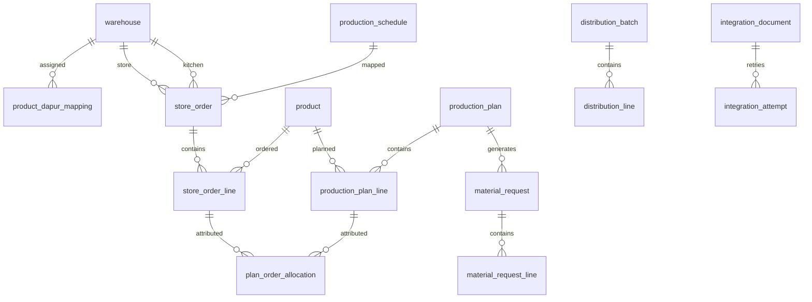

# DDL PostgreSQL — RO Middleware (Draft v0.1)
**Tanggal:** 2026-11-05  
**Status:** Usulan skema untuk review, **belum migration produksi**.  
**Prinsip:** Odoo adalah sumber resmi SKU/BoM/stok dan dokumen manufaktur/transfer; tabel master terkait adalah cache/snapshot referensi. Semua timestamp disimpan `timestamptz` (UTC), disajikan ke pengguna sebagai Asia/Jakarta.

## Diagram relasi (konseptual)


## SQL — tabel inti yang diusulkan
```sql
CREATE EXTENSION IF NOT EXISTS pgcrypto;

CREATE TABLE app_user (
 id uuid PRIMARY KEY DEFAULT gen_random_uuid(),
 username varchar(120) NOT NULL UNIQUE,
 password_hash text NOT NULL,
 full_name varchar(200) NOT NULL,
 active boolean NOT NULL DEFAULT true,
 is_superuser boolean NOT NULL DEFAULT false,
 created_at timestamptz NOT NULL DEFAULT now(),
 updated_at timestamptz NOT NULL DEFAULT now()
);
CREATE TABLE app_role (
 code varchar(30) PRIMARY KEY CHECK (code IN ('STORE','PRODUCTION','PACKING','ADMIN')),
 name varchar(100) NOT NULL
);
CREATE TABLE user_role (
 user_id uuid NOT NULL REFERENCES app_user(id),
 role_code varchar(30) NOT NULL REFERENCES app_role(code),
 PRIMARY KEY (user_id, role_code)
);

CREATE TABLE warehouse (
 id uuid PRIMARY KEY DEFAULT gen_random_uuid(),
 odoo_warehouse_id bigint UNIQUE,
 name varchar(160) NOT NULL,
 code varchar(32) NOT NULL UNIQUE,
 warehouse_kind varchar(24) NOT NULL CHECK (warehouse_kind IN ('CENTRAL','KITCHEN','PACKING','STORE')),
 active boolean NOT NULL DEFAULT true,
 synced_at timestamptz
);
CREATE TABLE stock_location (
 id uuid PRIMARY KEY DEFAULT gen_random_uuid(),
 odoo_location_id bigint UNIQUE,
 warehouse_id uuid NOT NULL REFERENCES warehouse(id),
 full_name varchar(180) NOT NULL,
 active boolean NOT NULL DEFAULT true,
 UNIQUE (warehouse_id, full_name)
);
CREATE TABLE user_warehouse_access (
 user_id uuid NOT NULL REFERENCES app_user(id),
 warehouse_id uuid NOT NULL REFERENCES warehouse(id),
 PRIMARY KEY (user_id, warehouse_id)
);
CREATE TABLE product (
 id uuid PRIMARY KEY DEFAULT gen_random_uuid(),
 odoo_product_id bigint NOT NULL UNIQUE,
 sku varchar(100),
 name varchar(255) NOT NULL,
 category_name varchar(100),
 uom_name varchar(60),
 active boolean NOT NULL DEFAULT true,
 synced_at timestamptz,
 UNIQUE (sku)
);
CREATE TABLE bom_header (
 id uuid PRIMARY KEY DEFAULT gen_random_uuid(),
 odoo_bom_id bigint NOT NULL UNIQUE,
 product_id uuid NOT NULL REFERENCES product(id),
 output_qty numeric(18,6) NOT NULL CHECK (output_qty > 0),
 output_uom varchar(60),
 active boolean NOT NULL DEFAULT true,
 synced_at timestamptz
);
CREATE TABLE bom_component (
 id uuid PRIMARY KEY DEFAULT gen_random_uuid(),
 bom_id uuid NOT NULL REFERENCES bom_header(id) ON DELETE CASCADE,
 component_product_id uuid NOT NULL REFERENCES product(id),
 component_qty numeric(18,6) NOT NULL CHECK (component_qty >= 0),
 component_uom varchar(60),
 UNIQUE (bom_id, component_product_id)
);
CREATE TABLE product_dapur_mapping (
 product_id uuid PRIMARY KEY REFERENCES product(id),
 warehouse_id uuid NOT NULL REFERENCES warehouse(id),
 effective_from timestamptz NOT NULL DEFAULT now(),
 updated_by uuid REFERENCES app_user(id),
 updated_at timestamptz NOT NULL DEFAULT now()
);
CREATE TABLE production_schedule (
 id uuid PRIMARY KEY DEFAULT gen_random_uuid(),
 code varchar(40) NOT NULL UNIQUE,
 name varchar(120) NOT NULL,
 sequence_no integer NOT NULL,
 active boolean NOT NULL DEFAULT true,
 created_at timestamptz NOT NULL DEFAULT now()
);
CREATE TABLE delivery_schedule (
 id uuid PRIMARY KEY DEFAULT gen_random_uuid(),
 code varchar(40) NOT NULL UNIQUE,
 name varchar(120) NOT NULL,
 production_schedule_id uuid NOT NULL REFERENCES production_schedule(id),
 active boolean NOT NULL DEFAULT true
);
CREATE TABLE sku_schedule_capacity (
 product_id uuid NOT NULL REFERENCES product(id),
 production_schedule_id uuid NOT NULL REFERENCES production_schedule(id),
 max_qty numeric(18,6) NOT NULL CHECK (max_qty >= 0),
 updated_at timestamptz NOT NULL DEFAULT now(),
 PRIMARY KEY (product_id, production_schedule_id)
);
CREATE TABLE min_stock_rule (
 product_id uuid NOT NULL REFERENCES product(id),
 warehouse_id uuid NOT NULL REFERENCES warehouse(id),
 min_qty numeric(18,6) NOT NULL CHECK (min_qty >= 0),
 updated_at timestamptz NOT NULL DEFAULT now(),
 PRIMARY KEY (product_id, warehouse_id)
);
CREATE TABLE store_order (
 id uuid PRIMARY KEY DEFAULT gen_random_uuid(),
 store_warehouse_id uuid NOT NULL REFERENCES warehouse(id),
 production_warehouse_id uuid NOT NULL REFERENCES warehouse(id),
 order_date date NOT NULL,
 delivery_date date NOT NULL,
 delivery_schedule_id uuid NOT NULL REFERENCES delivery_schedule(id),
 status varchar(20) NOT NULL DEFAULT 'DRAFT' CHECK (status IN ('DRAFT','KIRIM','NO_ORDER')),
 submitted_at timestamptz,
 submitted_by uuid REFERENCES app_user(id),
 auto_submitted boolean NOT NULL DEFAULT false,
 created_by uuid REFERENCES app_user(id),
 created_at timestamptz NOT NULL DEFAULT now(),
 updated_at timestamptz NOT NULL DEFAULT now(),
 UNIQUE (store_warehouse_id, production_warehouse_id, delivery_date, delivery_schedule_id)
);
CREATE TABLE store_order_line (
 id uuid PRIMARY KEY DEFAULT gen_random_uuid(),
 store_order_id uuid NOT NULL REFERENCES store_order(id) ON DELETE CASCADE,
 product_id uuid NOT NULL REFERENCES product(id),
 qty_requested numeric(18,6) NOT NULL DEFAULT 0 CHECK (qty_requested >= 0),
 UNIQUE (store_order_id, product_id)
);
CREATE TABLE production_plan (
 id uuid PRIMARY KEY DEFAULT gen_random_uuid(),
 production_warehouse_id uuid NOT NULL REFERENCES warehouse(id),
 production_date date NOT NULL,
 delivery_date date NOT NULL,
 production_schedule_id uuid NOT NULL REFERENCES production_schedule(id),
 status varchar(20) NOT NULL DEFAULT 'DRAFT' CHECK (status IN ('DRAFT','REVIEWED','PUSHING','PUSHED','PARTIAL','ERROR')),
 revision integer NOT NULL DEFAULT 1,
 finalized_at timestamptz,
 created_at timestamptz NOT NULL DEFAULT now(),
 UNIQUE (production_warehouse_id, production_date, delivery_date, production_schedule_id)
);
CREATE TABLE production_plan_line (
 id uuid PRIMARY KEY DEFAULT gen_random_uuid(),
 plan_id uuid NOT NULL REFERENCES production_plan(id) ON DELETE CASCADE,
 product_id uuid NOT NULL REFERENCES product(id),
 bom_id uuid NOT NULL REFERENCES bom_header(id),
 qty_requested numeric(18,6) NOT NULL DEFAULT 0 CHECK (qty_requested >= 0),
 qty_planned numeric(18,6) NOT NULL DEFAULT 0 CHECK (qty_planned >= 0),
 qty_mo numeric(18,6) NOT NULL DEFAULT 0 CHECK (qty_mo >= 0),
 capacity_snapshot numeric(18,6) NOT NULL CHECK (capacity_snapshot >= 0),
 bom_output_snapshot numeric(18,6) NOT NULL CHECK (bom_output_snapshot > 0),
 updated_by uuid REFERENCES app_user(id),
 updated_at timestamptz NOT NULL DEFAULT now(),
 UNIQUE (plan_id, product_id),
 CHECK (qty_mo <= capacity_snapshot)
);
CREATE TABLE plan_order_allocation (
 plan_line_id uuid NOT NULL REFERENCES production_plan_line(id) ON DELETE CASCADE,
 store_order_line_id uuid NOT NULL REFERENCES store_order_line(id),
 qty_requested_snapshot numeric(18,6) NOT NULL CHECK (qty_requested_snapshot >= 1),
 PRIMARY KEY (plan_line_id, store_order_line_id)
);
CREATE TABLE stock_snapshot (
 id uuid PRIMARY KEY DEFAULT gen_random_uuid(),
 product_id uuid NOT NULL REFERENCES product(id),
 location_id uuid NOT NULL REFERENCES stock_location(id),
 available_qty numeric(18,6) NOT NULL,
 captured_at timestamptz NOT NULL DEFAULT now(),
 source varchar(40) NOT NULL DEFAULT 'ODOO'
);
CREATE TABLE material_request (
 id uuid PRIMARY KEY DEFAULT gen_random_uuid(),
 plan_id uuid NOT NULL UNIQUE REFERENCES production_plan(id),
 source_warehouse_id uuid NOT NULL REFERENCES warehouse(id),
 destination_warehouse_id uuid NOT NULL REFERENCES warehouse(id),
 status varchar(20) NOT NULL DEFAULT 'DRAFT' CHECK (status IN ('DRAFT','READY','PUSHING','PUSHED','PARTIAL','ERROR')),
 reviewed_by uuid REFERENCES app_user(id),
 reviewed_at timestamptz,
 created_at timestamptz NOT NULL DEFAULT now()
);
CREATE TABLE material_request_line (
 id uuid PRIMARY KEY DEFAULT gen_random_uuid(),
 request_id uuid NOT NULL REFERENCES material_request(id) ON DELETE CASCADE,
 product_id uuid NOT NULL REFERENCES product(id),
 gross_qty numeric(18,6) NOT NULL CHECK (gross_qty >= 0),
 stock_available_snapshot numeric(18,6) NOT NULL DEFAULT 0,
 minimum_qty numeric(18,6) NOT NULL CHECK (minimum_qty >= 0),
 buffer_extra numeric(18,6) NOT NULL DEFAULT 0 CHECK (buffer_extra >= 0),
 requested_qty numeric(18,6) GENERATED ALWAYS AS (minimum_qty + buffer_extra) STORED,
 UNIQUE (request_id, product_id)
);
CREATE TABLE distribution_batch (
 id uuid PRIMARY KEY DEFAULT gen_random_uuid(),
 delivery_date date NOT NULL,
 delivery_schedule_id uuid NOT NULL REFERENCES delivery_schedule(id),
 status varchar(20) NOT NULL DEFAULT 'DRAFT' CHECK (status IN ('DRAFT','READY','PUSHING','PUSHED','PARTIAL','ERROR')),
 created_by uuid REFERENCES app_user(id),
 created_at timestamptz NOT NULL DEFAULT now(),
 UNIQUE (delivery_date, delivery_schedule_id)
);
CREATE TABLE distribution_line (
 id uuid PRIMARY KEY DEFAULT gen_random_uuid(),
 batch_id uuid NOT NULL REFERENCES distribution_batch(id) ON DELETE CASCADE,
 store_warehouse_id uuid NOT NULL REFERENCES warehouse(id),
 product_id uuid NOT NULL REFERENCES product(id),
 qty_requested_snapshot numeric(18,6) NOT NULL DEFAULT 0,
 qty_allocated numeric(18,6) NOT NULL DEFAULT 0 CHECK (qty_allocated >= 0),
 updated_by uuid REFERENCES app_user(id),
 UNIQUE (batch_id, store_warehouse_id, product_id)
);
CREATE TABLE source_document_counter (
 warehouse_id uuid NOT NULL REFERENCES warehouse(id),
 issue_date date NOT NULL,
 last_value bigint NOT NULL DEFAULT 10000 CHECK (last_value >= 10000),
 PRIMARY KEY (warehouse_id, issue_date)
);
CREATE TABLE integration_document (
 id uuid PRIMARY KEY DEFAULT gen_random_uuid(),
 doc_kind varchar(30) NOT NULL CHECK (doc_kind IN ('MO','MATERIAL_TRANSFER','FINISHED_TRANSFER','PACKAGE_MO','DELIVERY')),
 source_document varchar(100) NOT NULL UNIQUE,
 origin_id uuid NOT NULL,
 odoo_model varchar(120) NOT NULL,
 odoo_record_id bigint,
 sync_status varchar(20) NOT NULL DEFAULT 'PENDING' CHECK (sync_status IN ('PENDING','PROCESSING','SUCCEEDED','FAILED','UNKNOWN')),
 idempotency_key uuid NOT NULL UNIQUE DEFAULT gen_random_uuid(),
 payload jsonb NOT NULL,
 last_error text,
 created_at timestamptz NOT NULL DEFAULT now(),
 synced_at timestamptz,
 UNIQUE (odoo_model, odoo_record_id)
);
CREATE TABLE integration_attempt (
 id uuid PRIMARY KEY DEFAULT gen_random_uuid(),
 integration_document_id uuid NOT NULL REFERENCES integration_document(id),
 attempt_no integer NOT NULL CHECK (attempt_no >= 1),
 started_at timestamptz NOT NULL DEFAULT now(),
 ended_at timestamptz,
 outcome varchar(20) CHECK (outcome IN ('SUCCEEDED','FAILED','UNKNOWN')),
 error_message text,
 UNIQUE (integration_document_id, attempt_no)
);
CREATE TABLE audit_event (
 id bigint GENERATED ALWAYS AS IDENTITY PRIMARY KEY,
 actor_id uuid REFERENCES app_user(id),
 entity_type varchar(90) NOT NULL,
 entity_id uuid,
 action varchar(90) NOT NULL,
 before_data jsonb,
 after_data jsonb,
 happened_at timestamptz NOT NULL DEFAULT now()
);
CREATE INDEX idx_order_status_date ON store_order(status, delivery_date);
CREATE INDEX idx_order_line_product ON store_order_line(product_id);
CREATE INDEX idx_plan_schedule ON production_plan(production_date, production_schedule_id);
CREATE INDEX idx_material_product ON material_request_line(product_id);
CREATE INDEX idx_distribution_store ON distribution_line(store_warehouse_id);
CREATE INDEX idx_integration_status ON integration_document(sync_status, created_at);
CREATE INDEX idx_audit_entity ON audit_event(entity_type, entity_id, happened_at);
```

## Aturan yang tidak cukup dijaga oleh CHECK/DDL
- **Django migration:** jika memakai Django custom user model, selaraskan tabel `app_user` dengan auth backend Django; SQL ini adalah *logical schema draft*, **bukan** instruksi membuat auth table secara manual berdampingan dengan auth Django.
- **Submit:** lakukan dalam DB transaction: validasi Qty integer ≥1 (jika UoM pcs), hapus baris zero dari order terkirim, set KIRIM/NO_ORDER; gunakan `select_for_update` untuk race manual versus auto.
- **Auto H-2 07.00 WIB:** scheduler harus idempotent; unique order per store × dapur × delivery date × slot.
- **Plan:** konsolidasi deterministik dari Kirim, simpan atribusi order-line, revisi dan snapshot output BoM; validasi `qty_mo = ceil(qty_planned/output)*output` di domain service, bukan hanya batas DDL.
- **Stock planning:** stok dapur snapshot dari Odoo + kurangi yang sudah dialokasikan pada jadwal sebelumnya; hindari double count. Penentuan available vs on-hand, UoM serta rounding masih perlu ditetapkan.
- **Sumber dokumen:** dalam transaction, atomic upsert counter row per warehouse+tanggal WIB kemudian `UPDATE ... RETURNING last_value`; issue code `WH-YYMMDD-NNNNN`; jangan reuse.
- **Odoo API:** outbox record disimpan sebelum kirim; periksa remote reference/idempotency sebelum retry saat outcome UNKNOWN. Jangan pernah menyimpulkan gagal hanya karena timeout. Odoo native ID dan source document dicatat.
- **QA/restore:** restore DB tidak boleh mengirim ulang outbox tanpa rekonsiliasi; backup rahasia/kredensial terpisah; audit tidak bisa diedit dari UI biasa.
- **MO Paket:** gunakan product kategori PAKET dan lokasi PCK/Packing; BOM Paket tidak menginisiasi MO komponen otomatis.
- **Source document:** tentukan warehouse pemilik untuk jenis dokumen multi lokasi (open decision).
- **Kebutuhan lebih lanjut:** versi BoM, historisasi mapping dapur, granularitas distribusi per jadwal versus dapur, snapshot penerimaan Packing, stok WIP/premix, dan inventory/UoM conversion perlu review sebelum migrasi production.

## Contoh penerbitan counter (pseudocode transaksi)
```sql
INSERT INTO source_document_counter (warehouse_id, issue_date, last_value)
VALUES (:warehouse_id, :today_wib, 10001)
ON CONFLICT (warehouse_id, issue_date)
DO UPDATE SET last_value = source_document_counter.last_value + 1
RETURNING last_value;
```
Terbitkan source document memakai kode warehouse yang sudah tersimpan, tanggal WIB dan nilai hasil RETURNING. Uniqueness akhir tetap dijaga oleh `integration_document.source_document`.

> **Catatan:** DDL ini sengaja menggabungkan keputusan bisnis dengan *usulan* representasi database. Review model Django, normalisasi UoM, sinkronisasi dan model Odoo wajib dilakukan sebelum skema dipakai.
